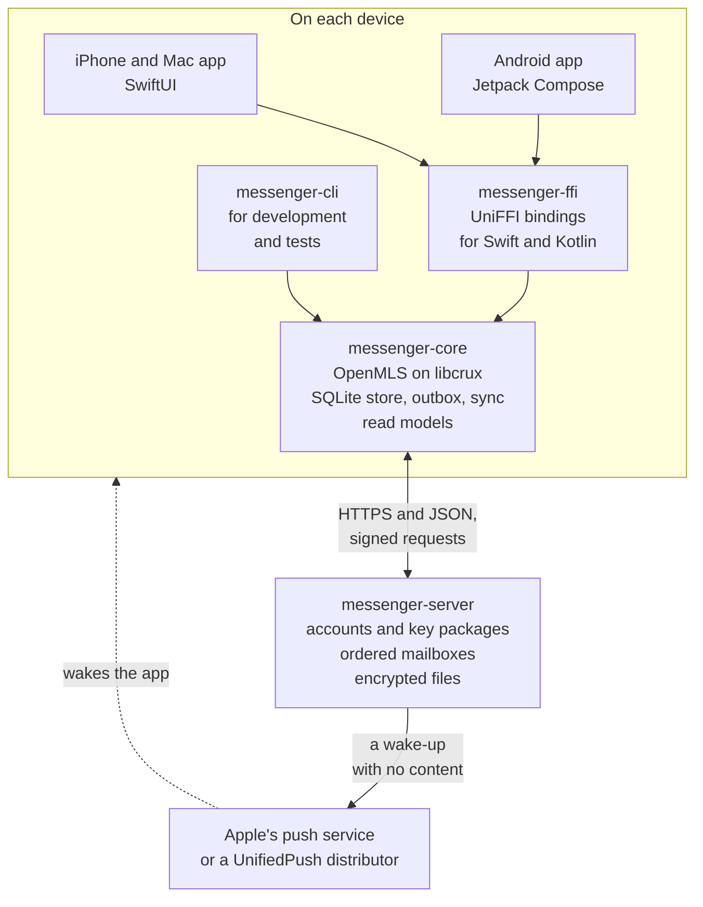
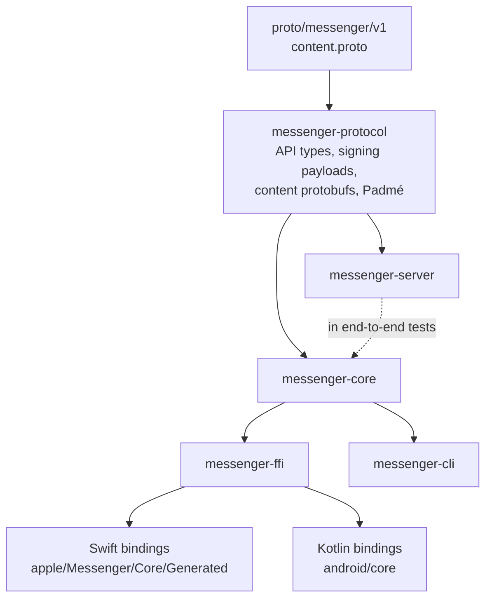
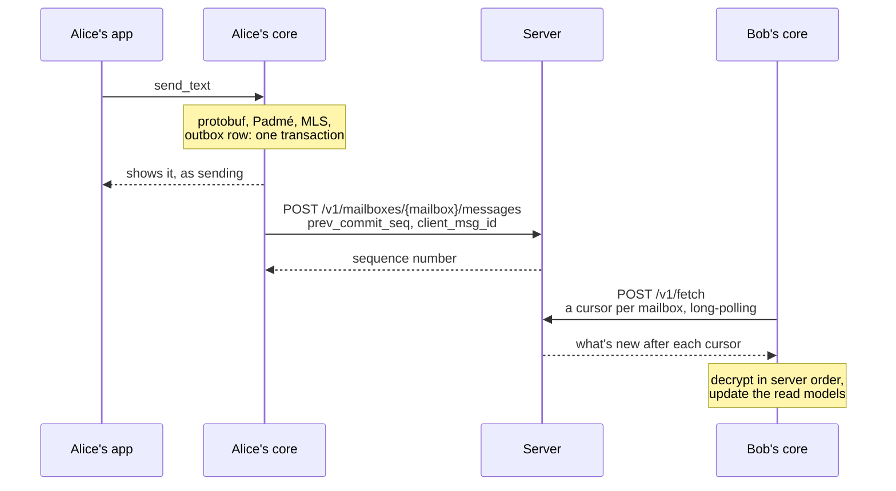
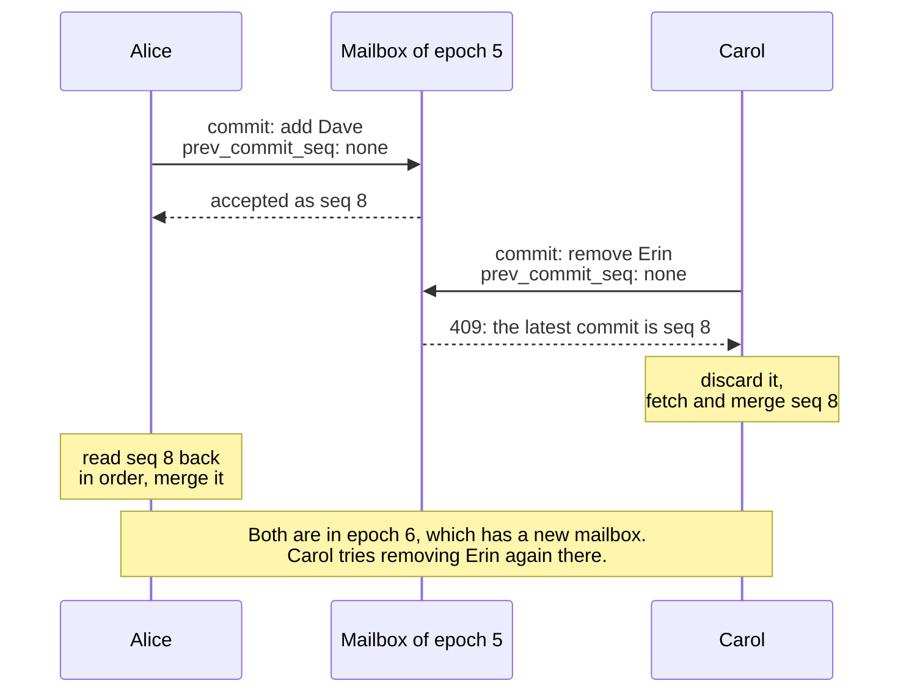
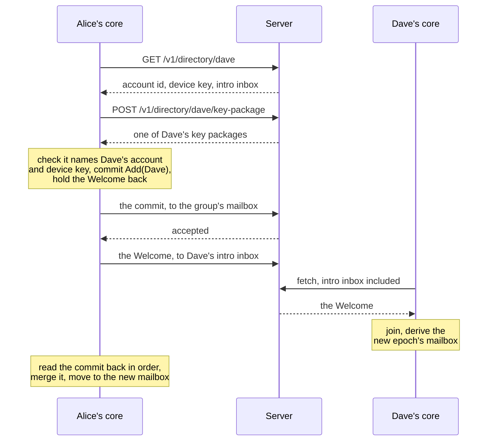
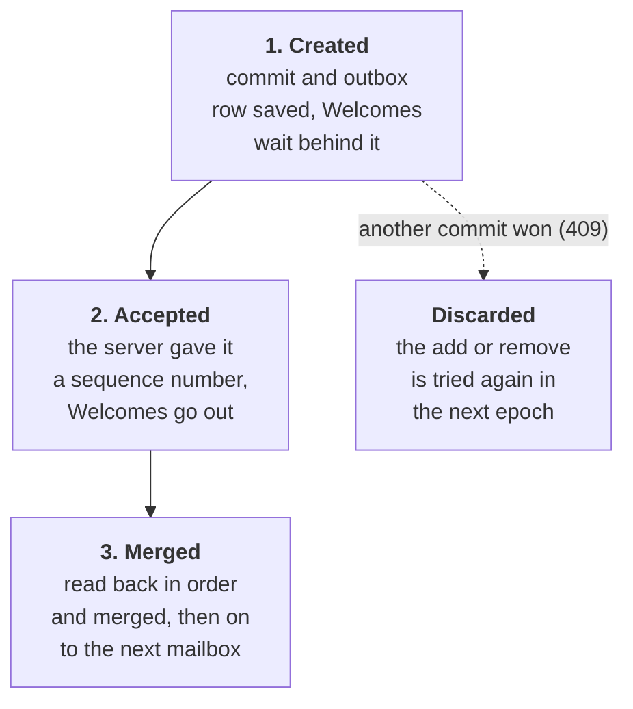
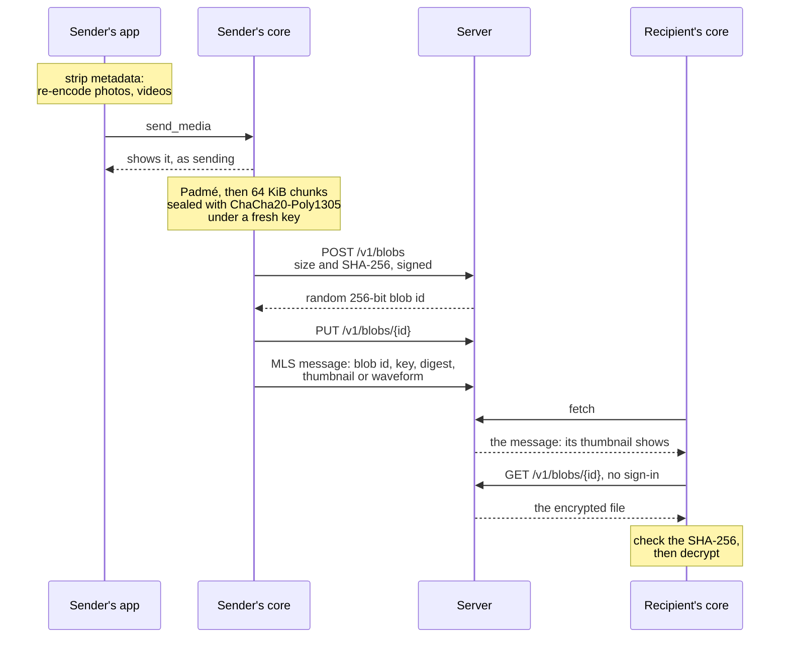
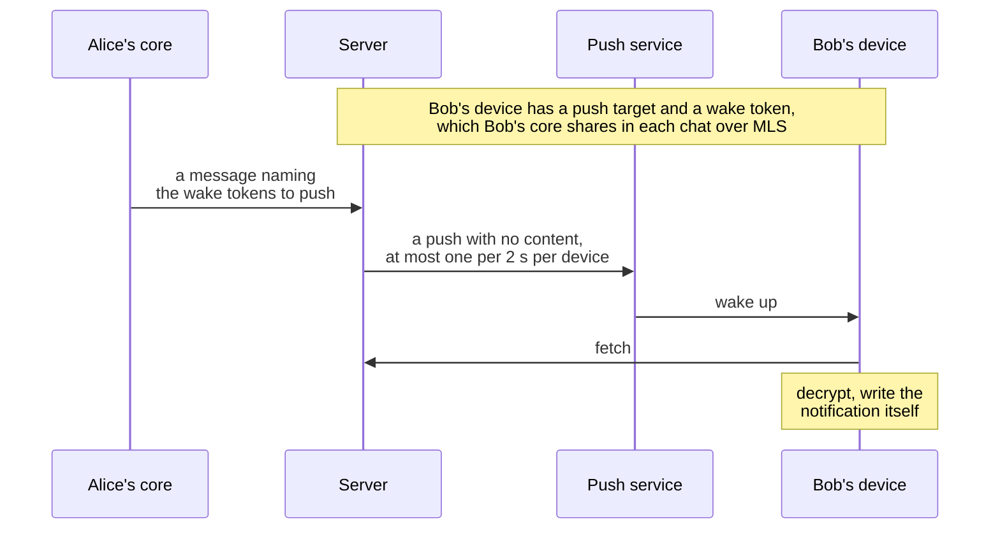

# Messenger

An end-to-end encrypted messenger for a small circle: you, your partner, your friends, and later a work space. Every conversation is an MLS group (RFC 9420) on the X-Wing hybrid post-quantum ciphersuite. The server only relays ciphertext between mailboxes it can't link together.

One Rust core runs on every platform. Native apps sit on top of it: SwiftUI for iPhone and Mac (iOS 17, macOS 14), Jetpack Compose for Android (8.0 and later), and a command-line client for development and tests.

- [What works](#what-works)
- [How it fits together](#how-it-fits-together): the pieces, the code, identity, sending, ordering, adding people, crash safety, files, notifications, location, what the server learns, the API
- [Run it](#run-it): the server, tests, the CLI, the apps, notifications, generated code
- [CI and releases](#ci-and-releases)
- [More](#more)

## What works

This is Phase 0 plus the v0.1 app shell. Working today:

- registration with a recovery key, recovery onto a new device, and replacing a lost recovery key;
- 1:1 and group chats, with replies, threads, reactions with any emoji, edits and delete-for-everyone;
- adding and removing members, leaving a group or ending a 1:1 chat, with concurrent changes resolved by the server's ordering rule;
- read receipts and typing indicators, each of which can be turned off (both ways);
- live location sharing with a map, for an hour, the day, or until stopped; end-to-end encrypted like messages;
- photos, videos, voice messages and files, encrypted end to end and kept on the server as blobs it can't read; photos and videos lose where, when and on what they were taken before they go;
- notifications from pushes that carry nothing readable: UnifiedPush on Android, Apple's push service on iPhone and Mac with a paid developer account, and local notifications while the app runs;
- drawn avatars (30 animals), inks, chat paper, 30 nature doodle wallpapers, colourful illustrations and helper cards;
- deleting the account, or removing it from a device;
- panic wipe: triple-tap “Chats” (⌥⇧⌘⌫ on the Mac) to erase the device at once, with no network;
- app lock with Face ID, Touch ID, fingerprint or the device passcode; hiding the app in the app switcher; blocking screenshots on Android and screen capture on the Mac;
- safety numbers with QR codes;
- crash recovery at every step of a commit.

Not done yet, in roughly this order:

- SQLCipher and keys wrapped by the Secure Enclave / Android Keystore. **Today the local database is plain SQLite with keys inside**, excluded from backups.
- Message text in notifications on an iPhone where Messenger isn't running: the notification extension has to open the database through an App Group. Until then such a push shows "New message".
- Calls.
- Key transparency, Privacy Pass rate limiting, an OHTTP relay, and an external audit.

## How it fits together

[docs/ARCHITECTURE.md](docs/ARCHITECTURE.md) has every rule in full; this is the map.

### The pieces



The core owns all client state, including what the screens show: the chat list, timelines, threads, where people are. The apps render those read models and keep no state of their own, so iPhone, Mac and Android behave the same. They call the core on background threads.

### The code



| | |
|---|---|
| `crates/protocol` | Wire formats: HTTP API types, signing payloads, content protobufs, Padmé padding |
| `crates/core` | Client core: MLS (OpenMLS + libcrux), SQLite store, outbox, sync, read models, files, location, push, crash recovery |
| `crates/ffi` | UniFFI bindings, the only API the apps see |
| `crates/server` | Mailbox server: accounts, key package directory, ordered mailboxes, encrypted files, push |
| `crates/cli` | Command-line client for development and tests |
| `apple/` | Xcode project: one SwiftUI app for iPhone and Mac (`Messenger/Core` for the bindings and platform services, `Messenger/Views` for the screens), plus a notification extension |
| `android/` | Gradle project: the Compose app (`app`) and the core as an Android library (`core`) |
| `proto/` | Versioned formats that travel inside MLS |
| `design/` | Sources for the avatars, illustrations, chat paper and app icon, as SVG |
| `scripts/` | Bindings, artwork, emoji and icon generators, Rust builds for Xcode and Gradle, the kill test, the Mac disk image, CI's error annotations |
| `docs/` | Architecture, how to deploy and test, and where the work stands |

### Identity

- An account is a random 128-bit id, a username, and an Ed25519 device key that is also the device's MLS signature key. There are no passwords: requests are signed by the device key, with a timestamp window and a replay cache.
- At sign-up the app makes a 64-character recovery key, which can later move the account to a new device. Contacts then see a new safety number, and old history isn't restored. A lost recovery key can be replaced from Settings.
- Each MLS credential carries `{account_id, username}`. Key packages are checked when they're uploaded, and again by whoever adds the person.

### Conversations are MLS groups

Every conversation is an MLS group; a 1:1 chat is a group of two.

- Ciphersuite `0x004D`: X-Wing (ML-KEM-768 + X25519), ChaCha20-Poly1305, SHA-256, Ed25519, via OpenMLS on libcrux.
- Commits and messages are always encrypted (`PURE_CIPHERTEXT`), so the server can't see who joins or leaves.
- No past-epoch secrets are kept, which gives the best forward secrecy MLS allows.
- Content is protobuf ([`content.proto`](proto/messenger/v1/content.proto): text with replies, threads and files; reactions, edits, deletes, receipts, typing, locations, wake tokens, profiles), framed and padded with Padmé before MLS encrypts it.

### Sending and receiving



Messages are posted as soon as they're sent; anything that couldn't go waits in the outbox for the next sync. A sync sends what's queued, fetches every mailbox in one long-polling request, processes what came in order, and sends again. Posts are idempotent per client message id, so a retry after a lost response gets the original sequence number.

### Mailboxes and ordering

Each epoch of a group has its own mailbox: a 32-byte id derived from the MLS exporter. Only members can compute it, and it changes with every commit, so the server can't link a group's epochs together. Invitations go to each person's intro inbox.

The server orders everything with one rule: **a post is accepted only if its `prev_commit_seq` names the latest commit already in that mailbox.**



- At most one commit wins each epoch, and nothing is accepted from a member who hasn't seen the latest commit. A late message is refused the same way, then encrypted again in the new epoch and resent, so no member ever needs old epoch keys.
- An invalid commit is skipped by every honest member. Later posts name it in `prev_commit_seq`, so the group moves on.
- Everyone reads the same mailbox in the same order, so everyone sees the same timeline, in server order `(epoch, seq)`, with unsent messages at the end.

### Adding someone



Leaving posts an MLS Remove proposal for ourselves, and the next member to see it commits it. A 1:1 chat ends when either person leaves.

### Crash safety

OpenMLS writes group state through a storage provider that the core builds on the connection of an open SQLite transaction, so group state, outbox rows, messages and cursors commit together or not at all. A commit moves through three durable steps:



A client killed between any two steps resumes from disk. `cargo test` covers this in process, and `scripts/kill-test.sh` with real processes exiting abruptly.

### Files

Photos, videos, voice messages and other files travel outside MLS, as encrypted blobs on the server; the message that carries one holds what's needed to fetch and open it.



- Each chunk's nonce is its number plus a flag on the last one, so chunks can't be reordered, dropped or cut short without failing to open.
- The apps strip what files say about where, when and on what: photos are re-encoded to JPEG (at most 2048 px, no EXIF; GIFs go as they are), videos to 720p H.264 with no metadata (AVFoundation on Apple; Media3 and then `Mp4Scrubber` on Android).
- Photos and voice messages are fetched as soon as they arrive; videos and other files on a tap. A file whose message is deleted while it's on its way is thrown away.
- The server keeps files as long as messages (30 days by default), allows 100 MB per file and 2 GB per account per day, and gives an upload an hour to arrive. It never learns which account fetched a file.

### Notifications



- A push carries nothing: names and text never leave the device. Receipts, typing and locations name nobody, so they never wake anyone, and a reply in a group thread wakes only the people following it.
- Android uses UnifiedPush: a distributor app such as ntfy gives Messenger a Web Push endpoint, and the server encrypts each push to the device (RFC 8291) and signs it with VAPID (RFC 8292). No Google services needed.
- iPhone and Mac use Apple's push service, which needs a paid Apple developer account. The alert says "New message" until the app has synced and replaced it.
- The server folds bursts, stops at 300 pushes an hour per device, and forgets targets the push service reports gone.

### Location sharing

A position is an MLS application message in the chat it's shared with, so the server relays it without learning where anyone is. Sharing only starts on the device being located, runs for a set time or until stopped, and keeps no history: receivers hold only the latest position per person, and forget it when sharing stops, expires, or the person leaves. Maps are Apple Maps on iPhone and Mac, and MapLibre with OpenFreeMap tiles on Android.

### What the server learns

| It sees | It doesn't see |
|---|---|
| usernames, account ids, device and recovery public keys | message content, edits, reactions |
| key packages (public) | who is in which group (unless notifications are on), and group names |
| ciphertext sizes (Padmé-padded), timing, and the IP addresses of connections | which mailboxes belong to the same group across epochs |
| how many messages each mailbox holds | which account reads or posts to a mailbox, unless linked by IP and timing |
| which account uploaded a file, when, and its padded size | what the file is, which chat it went to, and which account fetched it |

Fetches are batched over one connection, so the server can link the mailboxes a device polls together; an OHTTP relay and per-mailbox fetching are planned. With notifications on, the server also learns which accounts each message wakes, and so who chats with whom; turning notifications off takes that away. [ARCHITECTURE.md](docs/ARCHITECTURE.md#what-the-server-learns) has the details and the known gaps.

### The API

JSON over HTTPS, with binary fields as base64url. Calls that act for an account are signed by its device key.

| Call | What it does |
|---|---|
| `POST /v1/accounts` | Register a username, device key, recovery key and intro inbox |
| `POST /v1/accounts/recover` | Move the account to a new device key, signed with the recovery key |
| `POST /v1/accounts/me/recovery-key` | Replace the recovery key |
| `DELETE /v1/accounts/me` | Delete the account, its key packages, its intro inbox and its files |
| `GET /v1/directory/{username}` | Look someone up: account id, device key, intro inbox |
| `POST /v1/directory/{username}/key-package` | Take one of their key packages, to add them to a group |
| `POST`, `DELETE /v1/key-packages` | Upload this device's key packages, or withdraw them |
| `GET /v1/key-packages/count` | How many are left |
| `POST /v1/mailboxes/{mailbox}/messages` | Post to a mailbox, under the ordering rule |
| `POST /v1/fetch` | Read several mailboxes after their cursors, long-polling |
| `GET`, `PUT`, `DELETE /v1/push` | What the server can push to; set or remove this device's push target |
| `POST /v1/push/wake-token` | A fresh wake token |
| `POST /v1/blobs` | Ask to upload a file of a given size and digest |
| `PUT`, `GET /v1/blobs/{id}` | Upload the file; fetch it with nothing but its id |

## Run it

You need Rust from [rustup.rs](https://rustup.rs). To put the server on the internet, build an APK or a Mac disk image, or run on an iPhone with a free Apple ID, see [docs/DEPLOY.md](docs/DEPLOY.md).

### A demo on one Mac

```sh
scripts/demo.sh          # server, Mac app as vimu, iPhone simulator as maya, chats filled in
scripts/demo.sh stop     # stop the demo server
```

It builds everything, starts a fresh server, and fills chats from three more people (alex, sam, kai) with photos, a voice message, a file, a thread and reactions, then opens both apps signed in. The apps' current data is moved to `build/demo/backup-<time>` first.

### The server

```sh
cargo run -p messenger-server -- --listen 0.0.0.0:8080
```

| Flag | Default | |
|---|---|---|
| `--listen` | `127.0.0.1:8080` | Address to listen on; `0.0.0.0:8080` lets phones on your network reach it |
| `--db` | `messenger-server.db` | SQLite database, created if missing |
| `--blobs` | `blobs` next to the database | Folder for encrypted files |
| `--retention-days` | 30 | How long undelivered messages and files are kept |
| `--max-file-mb` | 100 | Largest file people may send (at most 100) |
| `--daily-upload-mb` | 2048 | Most each account may upload in a day |
| `--push-contact` | `mailto:admin@localhost` | Who runs the server, for push services |
| `--allow-private-push` | off | Allow Web Push endpoints on private networks, for a push service on your LAN |
| `--apns-key`, `--apns-key-id`, `--apns-team-id` | none | Apple push key, for notifications on iPhone and Mac |
| `--apns-topic` | `com.qwantarc.messenger` | The app's bundle id |

Each flag can also be set in the environment, as `MESSENGER_LISTEN`, `MESSENGER_DB` and so on.

### Tests

```sh
cargo test --workspace     # unit tests, and end-to-end tests with real clients and a real server
scripts/kill-test.sh       # crash a client mid-commit, check it recovers
```

Before pushing, also run `cargo fmt --all` and `cargo clippy --workspace --all-targets -- -D warnings`.

### Two people on the CLI

```sh
cargo run -q -p messenger-cli -- --data /tmp/alice register alice
cargo run -q -p messenger-cli -- --data /tmp/bob register bob
cargo run -q -p messenger-cli -- --data /tmp/alice chat bob
cargo run -q -p messenger-cli -- --data /tmp/alice send bob "hi bob"
cargo run -q -p messenger-cli -- --data /tmp/bob watch
```

Files go the same way, encrypted on the server:

```sh
cargo run -q -p messenger-cli -- --data /tmp/alice send-file bob cat.jpg --caption "look"
cargo run -q -p messenger-cli -- --data /tmp/bob show alice              # the message, and its file's id
cargo run -q -p messenger-cli -- --data /tmp/bob download alice <id> --to cat.jpg
```

Every command explains itself with `--help`.

| | |
|---|---|
| Account | `register`, `recover`, `whoami`, `new-recovery-key`, `privacy`, `profile`, `profiles`, `sign-out`, `delete-account`, `wipe` |
| Chats | `chat`, `group`, `add`, `remove`, `leave`, `members`, `safety`, `list`, `show`, `thread` |
| Messages | `send` (with `--reply-to` or `--thread`), `send-file`, `download`, `react`, `edit`, `delete`, `typing` |
| Location | `share-location`, `stop-location`, `locate`, `locations` |
| Notifications | `push-info`, `push`, `push-off`, `notifications` |
| Syncing | `sync`, `watch` |

### iPhone and Mac

Open `apple/Messenger.xcodeproj`, pick a simulator or My Mac, and press Run. A build phase compiles the Rust core for the selected platform and adds any missing rustup targets. The first build takes several minutes; after that it's incremental.

- The simulator and the Mac app reach a server on the same Mac at `http://localhost:8080`.
- To run on your iPhone, even with a free Apple ID, follow [docs/DEPLOY.md](docs/DEPLOY.md#4-iphone-with-a-free-apple-id). In the app, use `http://<your-mac's-LAN-IP>:8080` as the server.

### Android

Open `android/` in Android Studio and run the `app` configuration. Gradle builds the Rust core with [cargo-ndk](https://github.com/bbqsrc/cargo-ndk); `scripts/android-build-rust.sh` installs the rustup targets and cargo-ndk on first use. You need an NDK (Settings → Android SDK → SDK Tools → NDK). The emulator reaches a server on the host at `http://10.0.2.2:8080`.

Running from Android Studio compiles the core only for the ABI of the device you deploy to. Command-line and CI builds compile both arm64-v8a and x86_64.

### Notifications

Pushes say only "wake up"; each app decrypts and writes its own notifications.

- Android uses UnifiedPush, so it works without Google services. Install a distributor app such as [ntfy](https://ntfy.sh) (F-Droid or its website), then check Settings → Notifications in Messenger. The server needs nothing extra. For a push service on your own network, start the server with `--allow-private-push`.
- iPhone and Mac need Apple's push service, which takes a paid Apple developer account: add the Push Notifications capability under Signing & Capabilities, and start the server with your APNs key:

  ```sh
  cargo run -p messenger-server -- --listen 0.0.0.0:8080 \
    --apns-key AuthKey_KEYID.p8 --apns-key-id KEYID --apns-team-id TEAMID \
    --apns-topic <your app's bundle id>
  ```

  Without it, the Mac shows notifications while Messenger runs, and the iPhone while Messenger is open, while it shares your location, and when iOS lets it refresh in the background.
- `--push-contact mailto:you@example.com` tells push services who runs the server.

### Generated code

Generated files are committed, so Xcode and Android Studio build without extra steps. Regenerate them after changing their sources; CI checks the bindings and the artwork are current.

| | |
|---|---|
| `scripts/bindings.sh` | Swift and Kotlin bindings from `crates/ffi` (`--check` only compares) |
| `scripts/artwork.py` | `Avatars` and `Artwork` in Swift and Kotlin from `design/avatars` and `design/artwork`; needs `pip install svgelements` |
| `scripts/emoji.py` | The emoji picker's `emoji.tsv`, from emojibase-data |
| `scripts/app-icons.py` | Every app icon size, from `design/artwork/mark.svg` |

## CI and releases

CI runs on every pull request: Rust (fmt, clippy, tests, the kill test, and the bindings and artwork checks) and, when a change touches them, an iOS Simulator and macOS build and an Android debug APK. Compiler errors show as annotations on the pull request.

"Release builds" is run by hand from the Actions tab. It builds an Android APK and a Mac disk image and drafts a GitHub release with both. The APK is signed with your own key once the `ANDROID_*` secrets are set; see [docs/DEPLOY.md](docs/DEPLOY.md).

## More

- [docs/ARCHITECTURE.md](docs/ARCHITECTURE.md): how it works, every rule in full, and what the server can and can't see.
- [docs/DEPLOY.md](docs/DEPLOY.md): running the server on a Mac or a VPS, Android signing, the Mac disk image, and an iPhone with a free Apple ID.
- [docs/HANDOFF.md](docs/HANDOFF.md): where the work stands, the rules for working on it, and what comes next.
